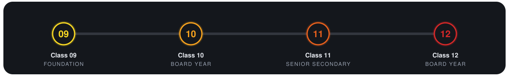
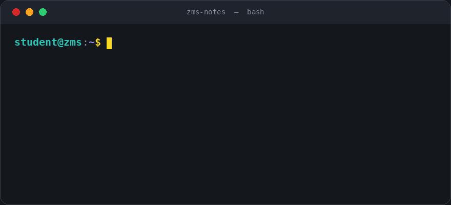

<div align="center">

<a href="https://github.com/parthbhuyan/ZMS_Notes">
  
</a>


<br>


<br>


<br><br>

<a href="#about"> <b>About</b></a>
&nbsp;&nbsp;·&nbsp;&nbsp;
<a href="#class-wise-notes"> <b>Notes</b></a>
&nbsp;&nbsp;·&nbsp;&nbsp;
<a href="#quick-start"> <b>Quick start</b></a>
&nbsp;&nbsp;·&nbsp;&nbsp;
<a href="#repository-map"> <b>Repo map</b></a>
&nbsp;&nbsp;·&nbsp;&nbsp;
<a href="#our-school"> <b>School</b></a>
&nbsp;&nbsp;·&nbsp;&nbsp;
<a href="#contribute"> <b>Contribute</b></a>


</div>

##  About

This repository holds the **Information Technology notes for CBSE Classes 9 to 12**, written and organised for the students of **Zion Mission School, Amba** (Doimukh, Papum Pare, Arunachal Pradesh).

The idea is simple: one place where every student can find chapter notes, practical files and lab setup guides, without hunting through chat groups or loose papers.

<div align="center">
  
</div>

<div align="center"></div>

##  Class-wise notes

Four years, one folder each. Pick your class and jump straight in.

<div align="center">
  
</div>

<br>

<table>
  <tr>
    <td width="50%"><a href="https://github.com/parthbhuyan/ZMS_Notes/tree/main/Class%209"></a></td>
    <td width="50%"><a href="https://github.com/parthbhuyan/ZMS_Notes/tree/main/Class10"></a></td>
  </tr>
  <tr>
    <td width="50%"><a href="https://github.com/parthbhuyan/ZMS_Notes/tree/main/Class11"></a></td>
    <td width="50%"><a href="https://github.com/parthbhuyan/ZMS_Notes/tree/main/Class12"></a></td>
  </tr>
  <tr>
    <td width="50%"><a href="https://github.com/parthbhuyan/ZMS_Notes/tree/main/Practical"></a></td>
    <td width="50%"><a href="https://github.com/parthbhuyan/ZMS_Notes/tree/main/Lab%20Setup"></a></td>
  </tr>
</table>

<div align="center"></div>

##  Quick start

<div align="center">
  
</div>

<br>

Pick whichever way suits you:

| | Way | How |
|:-:|:--|:--|
| **1** | **Read online** | Open a class folder above and click any file. GitHub previews most formats right in the browser. |
| **2** | **Download one file** | Open the file, then use the download icon at the top right of the viewer. |
| **3** | **Download everything** | Press the green **Code** button and choose **Download ZIP**. |
| **4** | **Clone with Git** | `git clone https://github.com/parthbhuyan/ZMS_Notes.git` |

> [!TIP]
> Press <kbd>T</kbd> anywhere on the repository page to search for a file by name.

<div align="center"></div>

##  Repository map

```text
ZMS_Notes/
├── Class 9/       Class 9 IT notes
├── Class10/       Class 10 IT notes
├── Class11/       Class 11 notes
├── Class12/       Class 12 notes
├── Practical/     practical files and programs
├── Lab Setup/     software and environment setup guides
├── assets/        banner, cards and icons used by this README
└── README.md      you are here
```

<div align="center"></div>

##  Our school

<table>
  <tr>
    <td align="center" width="170">
      
    </td>
    <td>
      <h3>Zion Mission School</h3>
      <b>Amba, Doimukh, Papum Pare, Arunachal Pradesh</b><br>
      Run by the Zion Mission Society, Nirjuli. A two-acre green campus about 3 km from Nirjuli town.<br><br>
      <i>"For Better Tomorrow"</i> &nbsp;·&nbsp; <i>"Time is Precious"</i><br><br>
      <sub>Open Mon to Fri 7:00 am – 5:00 pm &nbsp;·&nbsp; Sat 7:00 am – 12:00 pm &nbsp;·&nbsp; Sun closed</sub>
    </td>
  </tr>
</table>

<div align="center">

<a href="https://www.zionmissionschool.org/"></a>
<a href="https://parthbhuyan.github.io/zmscampus/"></a>
<br>
<a href="https://www.facebook.com/p/Zion-Mission-School-Amba-Doimukh-AP-61579111264519/"></a>
<a href="https://educonnectin.com/schools/arunachal-pradesh/papum-pare/doimukh/zion-mission-school"></a>

</div>

<div align="center"></div>

##  Contribute

Found a typo, a missing topic, or a clearer way to explain something? Students and teachers are welcome to help.

1. Open an [issue](https://github.com/parthbhuyan/ZMS_Notes/issues) describing what should change.
2. Or fork the repo, make your edit and open a pull request.
3. Keep file names clear, for example `Chapter-3-Networking.pdf`.

If these notes helped you, a ⭐ on the repo is the easiest way to say thanks, and it helps other students find it.

> [!NOTE]
> These notes are made for study and revision at Zion Mission School. They support, but do not replace, the official CBSE syllabus, textbooks and your teacher's guidance. Always check the latest syllabus on the [CBSE Academic website](https://cbseacademic.nic.in/).

<br>

<div align="center">

**Maintained by [Partha Bhuyan](https://github.com/parthbhuyan)** &nbsp;·&nbsp; [Portfolio](https://parthbhuyan.github.io/)

<br>


</div>
